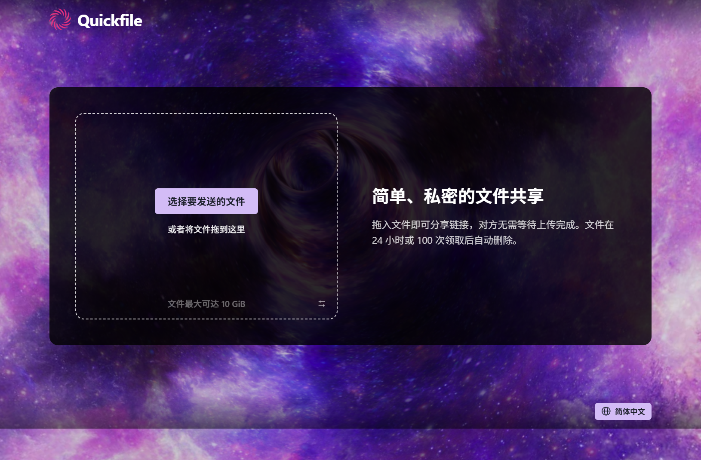
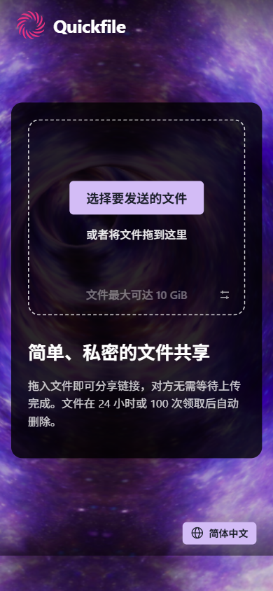

# Quickfile

[简体中文](README.md) | English

[](https://github.com/luodaoyi/quickfile/actions/workflows/build.yml)
[](LICENSE)

Drop your files and copy the link immediately. Uploads continue in the background, and recipients can start receiving before the upload finishes.

Quickfile is a Go file-sharing service with an embedded web interface. It runs as one executable with one data directory, automatically coordinating WebRTC peer-to-peer transfers and temporary server storage.

**[Use the hosted instance → file.011f.com](https://file.011f.com/)**

No installation or account is required. Open the website, choose your files, and share the link. You can also [download a binary](https://github.com/luodaoyi/quickfile/releases/latest) or self-host with a container.



<details>
<summary>View the mobile interface</summary>



</details>

## Features

| Feature | How it works |
| --- | --- |
| Instant links | Create a share link as soon as you select one or more files |
| Streaming downloads | Receive committed data while the sender continues uploading |
| Automatic P2P | Try WebRTC when the sender is online, then use HTTPS storage when a direct connection is unavailable |
| Download later | Once uploads finish, the sender can close the page |
| Chunking and resume | 4 MiB upload chunks, resumable uploads, HTTP Range requests, and download resume |
| Parallel downloads | Four concurrent chunks for individual files in browsers with file-writing support |
| Multiple files | Server-generated streaming ZIP downloads, including ZIP64 |
| Automatic cleanup | Expire after 24 hours or 100 pickups by default, whichever comes first |
| Simple interface | Animated galaxy, translucent panels, English/Chinese switching, and browser-local share history |
| One executable | Frontend assets are embedded in Go, with no database or Node.js runtime required |

**The limit is 10 GiB per file.** Each file in a multi-file share has its own size limit, and the server needs enough free disk space to store the uploads.

## Using Quickfile

1. Open [file.011f.com](https://file.011f.com/) and drop one or more files onto the page.
2. Copy and share the link while your files continue uploading.
3. Recipients can open the link and start downloading before the entire upload finishes.

The file picker offers files and folders. After selection, the share panel immediately shows the link, QR code, and live upload progress. Browsers with system sharing support also offer a Share button. The galaxy briefly accelerates when files are selected.

Keep the sender's page open until the share panel reports that uploading is complete. After that, recipients can still download until the share expires. To resume an interrupted upload, select the original files from the recent space entry.

## Self-hosting

### Binary

Download the appropriate file from [Releases](https://github.com/luodaoyi/quickfile/releases/latest). Each platform includes a SHA-256 checksum file.

| System | x86-64 / amd64 | ARM64 |
| --- | --- | --- |
| Linux | [Download](https://github.com/luodaoyi/quickfile/releases/latest/download/quickfile-linux-amd64) | [Download](https://github.com/luodaoyi/quickfile/releases/latest/download/quickfile-linux-arm64) |
| macOS | [Download](https://github.com/luodaoyi/quickfile/releases/latest/download/quickfile-darwin-amd64) | [Download](https://github.com/luodaoyi/quickfile/releases/latest/download/quickfile-darwin-arm64) |
| Windows | [Download](https://github.com/luodaoyi/quickfile/releases/latest/download/quickfile-windows-amd64.exe) | [Download](https://github.com/luodaoyi/quickfile/releases/latest/download/quickfile-windows-arm64.exe) |

On Linux or macOS, rename the downloaded file to `quickfile` and run it.

```sh
chmod +x quickfile
./quickfile --listen :8080 --data ./data
```

On Windows, run the downloaded EXE directly or specify a data directory in PowerShell.

```powershell
.\quickfile-windows-amd64.exe --listen :8080 --data .\data
```

Visit [http://localhost:8080](http://localhost:8080). For public deployments, configure HTTPS to enable direct transfers, clipboard access, and browser file-saving features.

### Docker Compose

The image `ghcr.io/luodaoyi/quickfile:latest` supports Linux amd64 and arm64. The following example is for Docker on Linux.

```sh
git clone https://github.com/luodaoyi/quickfile.git
cd quickfile
mkdir -p data
sudo chown 10001:10001 data
docker compose up -d
```

The included [compose.yaml](compose.yaml) mounts `./data` at `/data`, runs as UID/GID `10001:10001`, and binds the HTTP port to `127.0.0.1:8080`. The data directory must be writable by that user.

### Podman Compose

The same Compose configuration works with `podman-compose`. Rootful Podman uses the data directory ownership shown above.

```sh
podman-compose up -d
```

For rootless Podman, create a directory owned by your current user and set its mapped UID/GID before the first start.

```sh
mkdir -p data
podman unshare chown 10001:10001 data
podman-compose up -d
```

To update the application image, run the following commands.

```sh
podman pull ghcr.io/luodaoyi/quickfile:latest
podman-compose up -d --no-deps --force-recreate quickfile
```

### HTTPS and Cloudflare

You can use your own HTTPS reverse proxy. The repository also includes a [Caddyfile](deploy/Caddyfile) and [Compose extension](deploy/compose.public.yaml) with automatic certificates, streaming proxying, and a Cloudflare source-IP allowlist.

Replace `file.011f.com` in the example with your own domain, then copy both files into the directory containing `compose.yaml`.

```sh
docker compose -f compose.yaml -f compose.public.yaml up -d
# For Podman, replace docker compose with podman-compose
```

This configuration requires a proxied DNS A record pointing to your origin and Cloudflare SSL/TLS set to **Full (strict)**. Keep WebSockets enabled, bypass caching for `/api/*`, disable response buffering in your reverse proxy, and allow request bodies of at least 4 MiB. Update the Caddyfile when Cloudflare changes its published IP ranges.

## Configuration and storage

| Flag | Environment variable | Default |
| --- | --- | --- |
| `--listen` | `QUICKFILE_LISTEN` | `:8080` |
| `--data` | `QUICKFILE_DATA` | `./data`, or `/data` in the container |
| `--version` | — | Print the build version and exit |

Each space stores its `meta.json` and file data in the data directory. Run only one Quickfile instance against a given directory.

Share settings offer the following choices.

| Setting | Choices | Default |
| --- | --- | --- |
| Retention | 60 minutes, 2, 6, 12, or 24 hours | 24 hours |
| Maximum pickups | 1, 5, 10, 20, 50, or 100 | 100 |

- Retention starts when a space is created. Expiry stops ongoing transfers and allows cleanup, including incomplete uploads.
- Clicking download reserves one pickup. Chunks, retries, and transport changes reuse the same credential and do not consume additional pickups. Cancelling still consumes that pickup.
- A space becomes eligible for removal after its final pickup completes. Pickup credentials expire after two minutes without activity. Cleanup runs every 15 seconds and at startup.
- Recent spaces and upload credentials live in the current browser's local storage. Clearing site data removes that history and the credentials needed to resume uploads.

## Transfers and privacy

Individual files automatically use WebRTC or HTTPS. P2P discovery uses a public STUN service and does not require a self-hosted TURN server. The sender also uploads files to the server so recipients can collect them later. Multi-file ZIP downloads are generated and transferred by the server.

WebRTC uses DTLS, and public access uses HTTPS. **Stored files are written to the server disk as plaintext. This version does not implement client-side end-to-end encryption.** Share links only with the intended recipients.

Browsers with File System Access support can save four chunks in parallel. Other browsers use their native download manager. File-saving and resume behavior depend on browser support.

## Building and releases

Building from source requires Go 1.26 or later.

```sh
go build -trimpath -o quickfile .
```

[GitHub Actions](https://github.com/luodaoyi/quickfile/actions/workflows/build.yml) builds binaries for six platform/architecture combinations and Linux amd64/arm64 container images on pushes to `main`. Binaries and checksums are available as Actions Artifacts. Pushing a `v*` tag also publishes a GitHub Release and a versioned container image.

The health endpoint, `GET /healthz`, returns the service status and build version.

## API

| Request | Purpose |
| --- | --- |
| `POST /api/spaces` | Submit `{files:[{name,size}],hours,maxDownloads}` and immediately receive a space and upload credential |
| `GET /api/spaces/{id}` | Read the file list and committed upload offsets |
| `PATCH /api/spaces/{id}/files/{index}` | Append a chunk using the upload credential and `Upload-Offset` |
| `POST /api/spaces/{id}/claims` | Reserve a pickup using a random 48-character hexadecimal `{token}`; retries with the same token are idempotent |
| `POST /api/spaces/{id}/heartbeat` | Keep a pickup active |
| `GET /api/spaces/{id}/files/{index}` | Download a file or a byte range, waiting for data that has not arrived yet |
| `GET /api/spaces/{id}/archive` | Stream a ZIP download |
| `POST /api/spaces/{id}/complete` | Complete a pickup |
| `GET /api/spaces/{id}/ws` | WebSocket P2P signaling |

Upload and pickup credentials normally use `Authorization: Bearer <token>`. Native browser downloads use `?claim=<token>`. Server metadata stores SHA-256 credential hashes. Share requests and responses are not cached; pages disable referrers and load only bundled scripts.

## License and credits

Project code and original documentation are available under the [MIT License](LICENSE).

The interface is inspired by [Wormhole](https://wormhole.app/). The galaxy texture and mark come from its public website and remain the property of their respective owners; the project's MIT grant does not cover these third-party assets. The background uses Three.js r135, with its [MIT license](web/THREE-LICENSE.txt) retained. QR codes use [Project Nayuki's QR Code generator](https://www.nayuki.io/page/qr-code-generator-library), with the MIT license retained in its source.
