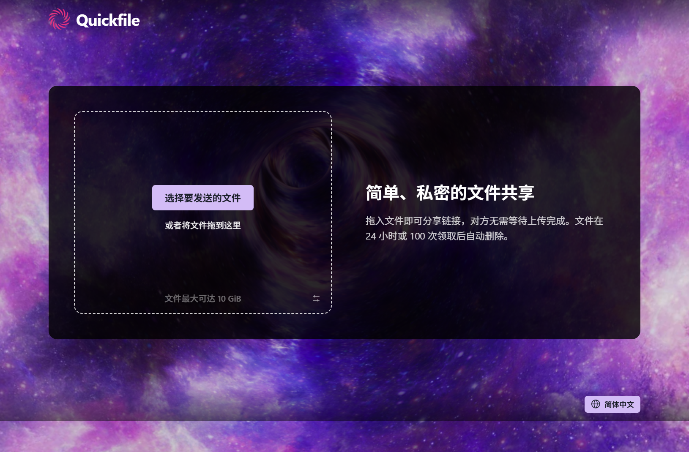
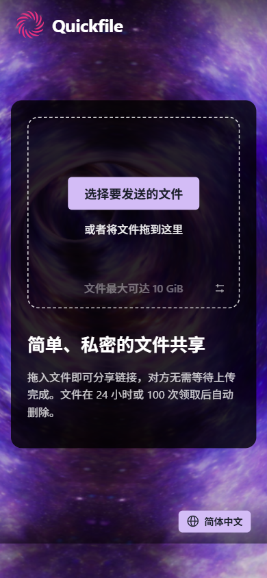

# Quickfile — 开源临时文件传输与大文件分享

简体中文 | [English](README.en.md)

[](https://github.com/luodaoyi/quickfile/actions/workflows/build.yml)
[](LICENSE)

拖入文件，立即复制链接。后台继续上传，对方可以在上传完成前开始接收。

Quickfile 是可自部署的开源临时文件传输与大文件分享工具（temporary file transfer / large file sharing）。单文件最大 10 GiB，支持 WebTorrent / WebRTC P2P、边传边下、自适应分片上传和上传续传；默认 24 小时或 100 次领取后自动删除，无需注册。

适合发送大视频、设计素材、日志和临时交付文件，也可作为自建的 Wormhole 替代方案。服务使用 Go 编写，前端随单个二进制分发，支持 Linux、Windows、macOS 和 Docker / Podman 部署。公开的 MCP 服务让 AI Agent 可以直接创建分享链接并传输文件。

**[立即使用在线站点 → file.011f.com](https://file.011f.com/)**

无需安装或注册。打开网页，选择文件，把链接发给对方即可。也可以[下载二进制](https://github.com/luodaoyi/quickfile/releases/latest)或使用容器自行部署。



<details>
<summary>查看手机界面</summary>



</details>

## 能做什么

| 功能 | 说明 |
| --- | --- |
| 即时分享 | 选好文件就生成链接，支持单文件和多文件 |
| 边传边下 | 接收方可以读取已经上传的数据，继续等待后续分片 |
| 自动直连 | 发送方在线时尝试 WebRTC P2P，直连不可用时使用 HTTPS 暂存路径 |
| 稍后领取 | 文件上传完成后，发送方可以关闭网页 |
| 分片与续传 | 4 MiB 上传分片，单文件和多文件统一调度，按分片耗时在 1–5 路间自适应并发；重启后可补齐缺片 |
| WebTorrent 下载 | 使用 WebTorrent 分片调度和 SHA-1 完整性校验，同时支持 WebRTC P2P 与领取凭据保护的 HTTP Web Seed |
| 多文件打包 | 网页从 WebTorrent 流生成 ZIP64 并流式保存；HTTP/MCP 继续支持服务端 ZIP |
| 自动删除 | 默认 24 小时或 100 次领取，先满足的条件生效 |
| 简单界面 | 银河动画、半透明面板、中英文切换和浏览器本地空间列表 |
| 单文件部署 | 前端随 Go 二进制分发，无数据库，无需 Node.js 运行时 |

**单文件上限为 10 GiB。** 多个文件分别受此限制，服务器需要有足够的剩余磁盘空间。

## 怎么使用

1. 打开 [file.011f.com](https://file.011f.com/)，拖入一个或多个文件。
2. 点击“复制链接”，发送给接收方。此时文件会继续上传。
3. 接收方打开链接即可下载，无需等待整个文件上传完成。

点击“选择要发送的文件”可选择文件或文件夹。选好后会立即进入分享面板，显示链接、二维码和上传进度；支持系统分享的浏览器还可直接分享链接。上传期间银河背景会短暂加速，完成后恢复。

上传过程中请保留发送页面。分享面板显示上传完成后，即使关闭网页，接收方仍可在有效期内领取。上传中断时，在“最近的空间”中重新选择原文件即可继续。

## 自行部署

### 使用二进制

从 [Releases](https://github.com/luodaoyi/quickfile/releases/latest) 下载对应文件。每个平台均提供 SHA-256 校验文件。

| 系统 | x86-64 / amd64 | ARM64 |
| --- | --- | --- |
| Linux | [下载](https://github.com/luodaoyi/quickfile/releases/latest/download/quickfile-linux-amd64) | [下载](https://github.com/luodaoyi/quickfile/releases/latest/download/quickfile-linux-arm64) |
| macOS | [下载](https://github.com/luodaoyi/quickfile/releases/latest/download/quickfile-darwin-amd64) | [下载](https://github.com/luodaoyi/quickfile/releases/latest/download/quickfile-darwin-arm64) |
| Windows | [下载](https://github.com/luodaoyi/quickfile/releases/latest/download/quickfile-windows-amd64.exe) | [下载](https://github.com/luodaoyi/quickfile/releases/latest/download/quickfile-windows-arm64.exe) |

Linux / macOS 示例，将下载的文件重命名为 `quickfile` 后运行。

```sh
chmod +x quickfile
./quickfile --listen :8080 --data ./data
```

Windows 可直接运行下载的 EXE，或在 PowerShell 中指定目录。

```powershell
.\quickfile-windows-amd64.exe --listen :8080 --data .\data
```

本机访问 [http://localhost:8080](http://localhost:8080)。公网部署请配置 HTTPS，以启用直连、剪贴板和浏览器文件保存功能。

### Docker Compose

镜像为 `ghcr.io/luodaoyi/quickfile:latest`，支持 Linux amd64 和 arm64。在已安装 Docker Compose 的 Linux 主机上，下载一份 `compose.yaml` 即可启动，镜像会自动拉取。

```sh
mkdir -p quickfile/data && cd quickfile
curl -fL https://raw.githubusercontent.com/luodaoyi/quickfile/main/compose.yaml -o compose.yaml
sudo chown 10001:10001 data
docker compose up -d
```

仓库内的 [compose.yaml](compose.yaml) 将 `./data` 挂载到 `/data`，以 UID/GID `10001:10001` 运行，并将端口绑定到 `127.0.0.1:8080`。数据目录必须可由该用户写入。

### Podman Compose

同一份 Compose 配置也可使用 `podman-compose` 运行。Rootful Podman 沿用上面的数据目录权限设置。

```sh
podman-compose up -d
```

使用 Rootless Podman 时，在首次启动前，创建由当前用户拥有的数据目录并设置 UID/GID 映射。

```sh
mkdir -p data
podman unshare chown 10001:10001 data
podman-compose up -d
```

更新镜像时可使用以下命令。

```sh
podman pull ghcr.io/luodaoyi/quickfile:latest
podman-compose up -d --no-deps --force-recreate quickfile
```

### HTTPS 和 Cloudflare

可以使用自己的 HTTPS 反向代理。仓库也提供了 [Caddyfile](deploy/Caddyfile) 和 [Compose 扩展](deploy/compose.public.yaml)，包含证书自动申请、流式转发和 Cloudflare 来源地址限制。

自行部署时，将示例中的 `file.011f.com` 换为自己的域名，再将两个文件复制到 `compose.yaml` 所在目录。

```sh
docker compose -f compose.yaml -f compose.public.yaml up -d
# Podman 使用 podman-compose 替换 docker compose
```

该示例需要将 DNS 设为指向源站的已代理 A 记录，Cloudflare SSL/TLS 使用 **Full (strict)**。保持 WebSocket 可用，禁用 `/api/*` 缓存，反向代理关闭响应缓冲，并允许至少 4 MiB 的请求正文。Cloudflare 官方地址段变化时，需要同步 Caddyfile。

## 配置与数据

| 参数 | 环境变量 | 默认值 |
| --- | --- | --- |
| `--listen` | `QUICKFILE_LISTEN` | `:8080` |
| `--data` | `QUICKFILE_DATA` | `./data`，容器内为 `/data` |
| `--version` | — | 输出构建版本并退出 |

每个空间在数据目录中保存一份 `meta.json` 和各文件的数据。一个数据目录只允许一个 Quickfile 实例写入。

分享设置支持以下选项。

| 项目 | 可选值 | 默认值 |
| --- | --- | --- |
| 保留时间 | 60 分钟、2、6、12、24 小时 | 24 小时 |
| 最多领取 | 1、5、10、20、50、100 次 | 100 次 |

- 有效期从空间创建时起算。到期后停止传输并清理，包括未完成上传的空间。
- 点击下载时预留一次领取。分片、重试和传输路径切换共用凭据，不重复计数。中途取消仍占一次领取。
- 最后一次领取完成后允许清理。领取凭据在两分钟无活动后失效，后台每 15 秒扫描一次，程序启动时也会清理。
- 最近空间和上传凭据保存在当前浏览器的本地存储中。清除站点数据会丢失本地记录和继续上传的凭据。

## 传输与隐私

网页使用 WebTorrent 调度每个文件的 4 MiB 分片，并校验 SHA-1。WebRTC P2P 和 HTTP Web Seed 共用分片调度；HTTP 源只声明服务器已确认的分片。每个文件使用独立的私有 torrent，不连接公共 tracker、DHT 或 LSD。P2P 通过公开 STUN 服务发现路径；无法直连时由 HTTP 源提供数据。发送方同时上传文件，以便之后离线领取。网页 ZIP 从这些文件流生成；HTTP/MCP 仍可使用服务端 ZIP。

WebRTC 使用 DTLS，公网访问通过 HTTPS。**暂存文件以原始数据保存在服务器磁盘上，当前版本没有客户端端到端加密。** 分享链接应只交给预期的接收方。

支持 File System Access 的浏览器直接流式写盘，其他支持 Service Worker 的浏览器使用原生下载器。接收分片暂存于 IndexedDB，并在本次传输结束时清理，因此浏览器必须有足够的站点存储配额。网页重新下载会重新调度分片；HTTP 客户端仍可通过 Range 续传。

## 构建与发布

源码构建需要 Go 1.26 或更新版本。WebTorrent 浏览器包已随源码提交，Go 构建无需 Node.js；修改依赖时先用 Node.js 22 或更新版本执行 `npm ci --ignore-scripts --no-audit --no-fund` 和 `npm run build:webtorrent`。CI 会重建浏览器包并检查差异。

```sh
go build -trimpath -o quickfile .
```

[GitHub Actions](https://github.com/luodaoyi/quickfile/actions/workflows/build.yml) 在推送 `main` 时构建六个平台的二进制，以及 Linux amd64/arm64 容器镜像。二进制和校验文件保存在 Actions Artifacts 中。推送 `v*` 标签时，自动发布 GitHub Release 和对应版本的容器镜像。

健康接口为 `GET /healthz`，返回服务状态和构建版本。

## MCP：让 Agent 分享文件

部署本版本后，导航栏的 **MCP** 菜单会打开使用说明和客户端配置弹窗。服务提供公开的 Streamable HTTP 入口 `/mcp`，不需要账号、API Key 或 OAuth；浏览器直接打开该地址会显示纯文本介绍。`/mcp/index.txt` 和 `/llms.txt` 也提供同一份索引，方便 Agent 自行读取配置说明。

Codex 配置示例（将地址替换为自己的部署地址）：

```toml
[mcp_servers.quickfile]
url = "https://file.011f.com/mcp"
```

调用 `share_file({"name":"hello.txt","text":"Hello!"})` 即可获取分享链接。多个文件或大文件使用 `create_space`、`upload_chunk`；Agent 必须先读取自己电脑上的文件，再提交 Base64 分片，远程 MCP 不读取客户端本地路径。也可将原始分片直接发送到返回的 HTTP 上传地址。

共 13 个工具覆盖全部 REST API，并提供 WebSocket 信令连接信息。`upload_chunk` 支持 `parallel:true`，`publish_torrent` 和 `get_torrent` 用于发布及获取分片元数据。文件下载支持 HTTP 地址或 Base64 字节范围，ZIP 使用 HTTP 流式下载。每个空间的上传凭据和领取凭据由工具返回并沿用原有校验，无需用户手动申请。领取一次后复用同一个 claim，在接收期间定期心跳，保存完成后调用 `complete_download`。

供搜索引擎和 AI 检索的入口包括 [项目与 Agent 说明](https://file.011f.com/llms.txt)、[站点地图](https://file.011f.com/sitemap.xml)和 [GitHub 源码](https://github.com/luodaoyi/quickfile)。首页提供标题、描述、分享卡片和结构化数据；临时领取页使用 `noindex`，不会列入站点地图。自部署时这些站点地址自动使用当前访问域名。

完整的 Codex、DeepSeek Harness、Claude Code、Cursor 配置和工具映射见 [MCP 索引模板](web/mcp.txt)，运行中的索引会自动使用当前站点地址。MCP 还提供 `quickfile://mcp/index` 资源。客户端自身的工具审批设置由客户端管理。

## API

| 请求 | 用途 |
| --- | --- |
| `POST /api/spaces` | 提交 `{files:[{name,size}],hours,maxDownloads}`，立即获取空间和上传凭据 |
| `GET /api/spaces/{id}` | 获取文件列表、连续已上传偏移和乱序分片 ranges |
| `PATCH /api/spaces/{id}/files/{index}` | 使用上传凭据和 `Upload-Offset` 追加分片；`Upload-Mode: parallel` 接受不重叠的乱序分片 |
| `POST /api/spaces/{id}/files/{index}/torrent` | 使用上传凭据发布不可变的 SHA-1 分片哈希 |
| `GET /api/spaces/{id}/files/{index}/torrent` | 使用上传或领取凭据获取私有 torrent |
| `POST /api/spaces/{id}/claims` | 提交随机的 48 位十六进制 `{token}`，预留领取次数，同 token 重试幂等 |
| `POST /api/spaces/{id}/heartbeat` | 延长当前领取的活动时间 |
| `GET /api/spaces/{id}/files/{index}` | 下载完整文件或 `Range` 指定的部分，等待尚未上传的数据 |
| `GET /api/spaces/{id}/archive` | 实时下载 ZIP |
| `POST /api/spaces/{id}/complete` | 完成领取 |
| `GET /api/spaces/{id}/ws` | WebSocket P2P 信令 |

上传和领取凭据通常使用 `Authorization: Bearer <token>`，浏览器原生下载使用 `?claim=<token>`。服务端元数据保存凭据的 SHA-256 摘要。分享请求和响应禁止缓存，页面禁用 Referrer，并只加载随程序提供的脚本。

## 协议与致谢

本项目代码和自行编写的文档采用 [MIT 协议](LICENSE)。WebTorrent 及浏览器依赖的版本锁定在 `package-lock.json`，保留[第三方许可声明](web/WEBTORRENT-LICENSES.txt)。

界面参考 [Wormhole](https://wormhole.app/)。银河纹理与标记来自其公开页面，这些素材的权利归原作者，项目的 MIT 授权不覆盖这些第三方素材。背景使用 Three.js r135 绘制，保留其 [MIT 许可证](web/THREE-LICENSE.txt)。银河渲染逻辑按 Wormhole 的公开前端实现移植，使用同版 GSAP 3.10.4 与 RoughEase，保留脚本中的 GreenSock 版权及许可声明；这部分第三方代码不包含在本项目的 MIT 授权中。二维码使用 [Project Nayuki 的 QR Code generator](https://www.nayuki.io/page/qr-code-generator-library)，保留代码中的 MIT 许可证。
